<a href="https://kronkorp.github.io/en/">
  
</a>

<p align="center">
  <a href="https://kronkorp.github.io/en/"><b>WEBSITE</b></a>&nbsp;&nbsp;//&nbsp;&nbsp;<a href="#01--engine"><b>ENGINE</b></a>&nbsp;&nbsp;//&nbsp;&nbsp;<a href="#02--libraries"><b>LIBRARIES</b></a>&nbsp;&nbsp;//&nbsp;&nbsp;<a href="#03--about"><b>ABOUT</b></a>&nbsp;&nbsp;//&nbsp;&nbsp;<a href="#04--members"><b>MEMBERS</b></a>
</p>

## 01 // Engine

**[KUGE](https://kronkorp.github.io/en/projects/KUGE/)** is a C++20 game engine made of independent blocks. A game links only the ones it needs: a solo game, a dedicated server and a game where one player hosts the match are all built from the same blocks.

| Module | What it does |
| --- | --- |
| `kuge-core` | The fixed-step loop, the scenes and the systems. |
| `kuge-client` | The window, inputs, 2D drawing, sounds, text and UI. |
| `kuge-physics` | 2D collisions. |
| `kuge-net` | The network. |
| `kuge-server` | Lobbies, on the server side. |
| `kuge-replication` | Client-side prediction. |

```cmake
add_executable(my_game main.cpp)
target_link_libraries(my_game PRIVATE kuge-client kuge-physics)   # brings kuge-core too
```

[Project page](https://kronkorp.github.io/en/projects/KUGE/) · [Repository](https://github.com/kronkorp/KUGE)

## 02 // Libraries

**Every block, written by hand.** The engine relies on these libraries. Each one has its own repository and documentation.

| | Repository | Language | What it is |
| :-: | --- | --- | --- |
| 🟨 | [`kronkworld`](https://kronkorp.github.io/en/projects/kronkworld/) | C++ | A light ECS, in C++. |
| 🟨 | [`kronk3d`](https://kronkorp.github.io/en/projects/kronk3d/) | C++ | A super fast and modern 3D hardware rasterizer. |
| 🟥 | [`kronknet`](https://kronkorp.github.io/kronknet/) | C | A low level network library in C. |
| 🟥 | [`kronkflow`](https://kronkorp.github.io/en/projects/kronkflow/) | C | A tiny task scheduler in C, built for the zappy project. |
| 🟥 | [`kronkpool`](https://kronkorp.github.io/en/projects/kronkpool/) | C | A simple thread pool in C using pthread. |
| 🟥 | [`kronklab`](https://kronkorp.github.io/en/projects/kronklab/) | C | A simple test framework in C. |
| 🟥 | [`kronkargs`](https://kronkorp.github.io/en/projects/kronkargs/) | C | A simple argument parser library, for C programs. |

## 03 // About

**Kronk Corp is an organization of Epitech students. Its goal: build a complete game engine from scratch.**

The principle: write every block yourself instead of importing one. All the code is open.

## 04 // Members

- [Gauthier Malfilatre](https://github.com/GauthierMalfilatre)
- [Ethan Bertin--Prévot](https://github.com/YknotTYD)
- [Clement Devaux](https://github.com/clementd-tek)
- [Julian Hemmer](https://github.com/julian-hemmer)
- [Romain Marcot](https://github.com/NetCatRunner)
